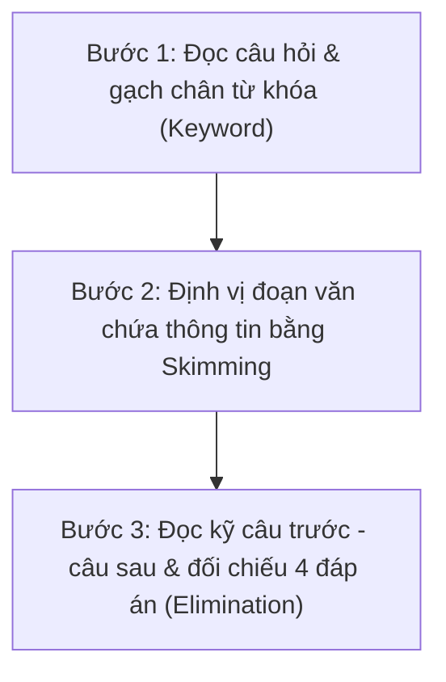

# 🎯 Phần 3: Chiến Thuật & Kỹ Năng Đột Phá Đọc Hiểu (読解 - Dokkai) N2

Đọc hiểu N2 là phần chiếm tới **60/180 điểm**, đóng vai trò quyết định đỗ hay trượt. Khác với N3 chỉ hỏi thông tin bề nổi, N2 kiểm tra **khả năng nắm bắt tư tưởng ngầm, góc nhìn phản biện và mạch logic của tác giả**.

---

## 1. Cấu Trúc Đề Thi Đọc Hiểu N2 & Phân Bổ Thời Gian Chuẩn

Tổng thời gian làm phần đọc hiểu lý tưởng là **60 phút** (sau khi đã dành 45 phút cho Từ vựng - Ngữ pháp).

| Phần | Dạng bài | Số lượng | Độ dài | Thời gian đề xuất | Trọng tâm |
| :--- | :--- | :--- | :--- | :--- | :--- |
| **Mondai 10** | Đoạn văn ngắn (短文) | 5 bài | ~200 chữ/bài | **12 - 14 phút** (2.5p/bài) | Thông báo công ty, bài luận ngắn, chỉ thị |
| **Mondai 11** | Đoạn văn trung (中文) | 3 bài (9 câu hỏi) | ~500 chữ/bài | **20 - 22 phút** (7p/bài) | Bình luận xã hội, tâm lý học, văn hóa |
| **Mondai 12** | Bài so sánh (統合理解) | 1 bài (2 câu hỏi) | ~600 chữ (2 đoạn A-B) | **8 - 9 phút** | Tìm điểm chung / đối lập giữa 2 tác giả |
| **Mondai 13** | Đoạn văn dài (長文) | 1 bài (3-4 câu hỏi) | ~1000 chữ | **12 - 14 phút** | Triết lý nhân sinh, tư duy trừu tượng |
| **Mondai 14** | Tìm kiếm thông tin (情報検索) | 1 bài (2 câu hỏi) | Bảng biểu, tờ rơi | **5 - 6 phút** | Đọc điều kiện, hạn chót, ngoại lệ |

---

## 2. Quy Trình 3 Bước Xử Lý Mọi Bài Đọc Hiểu

1. **Bước 1: ĐỌC CÂU HỎI TRƯỚC (Tuyệt đối không đọc toàn bài trước)**
   - Xác định rõ: Đề bài đang hỏi **Lý do (なぜ)**, **Nội dung cụ thể (どういうことか)** hay **Ý kiến tác giả (筆者の考え)**?
   - Khoanh tròn các từ khóa quan trọng trong câu hỏi.

2. **Bước 2: ĐỊNH VỊ VÙNG CHỨA ĐÁP ÁN**
   - Đọc lướt (Skimming) để tìm từ khóa xuất hiện ở đoạn nào trong bài.
   - Nguyên tắc bài thi JLPT: **Thứ tự câu hỏi đi tuần tự theo thứ tự các đoạn văn trong bài**.

3. **Bước 3: ĐỌC SÂU VÀ DÙNG PHƯƠNG PHÁP LOẠI TRỪ (消去法)**
   - Đọc kỹ **câu chứa từ khóa**, **1 câu liền trước** và **1 câu liền sau**.
   - So sánh với 4 phương án, gạch bỏ các phương án có dấu hiệu bẫy.

---

## 3. Dấu Hiệu Nhận Biết Quan Điểm Của Tác Giả (筆者の主張)

Trong 80% các bài đọc N2, tác giả không nói thẳng ý kiến ngay từ đầu mà thường dẫn dắt: "Mọi người thường nghĩ là A..." rồi bẻ lái: "Nhưng thực ra là B".

### A. Từ nối chuyển ý - "Đèn tín hiệu giao thông" của bài đọc
Ý chính của tác giả **LUÔN NẰM NGAY SAU** các từ chuyển hướng sau:
- **しかし / だが / ところが / けれども** (Tuy nhiên...)
- **むしろ** (Ngược lại / Đúng hơn là...)
- **要するに / つまり** (Tóm lại là / Nghĩa là...)
- **実は / 実際は** (Thực ra thì...)

> ⚠️ **Mẹo sống còn:** Nếu bài văn có câu mở đầu bằng `一般に...と言われている` (Người ta thường cho rằng...) hay `多くの人は...と思いがちだ` (Nhiều người có xu hướng nghĩ...), thì **đó KHÔNG PHẢI là quan điểm của tác giả**. Tác giả sắp sửa phản bác lại ý kiến đó!

### B. Các đuôi câu thể hiện quan điểm tác giả (Xuất hiện ở cuối bài)
- `〜のではないだろうか` / `〜のではないか`: Chẳng phải là... hay sao? (Khẳng định quan điểm một cách khiêm nhường).
- `〜に違いない`: Chắc chắn là...
- `〜べきだ` / `〜なければならない`: Cần phải... / Nên...
- `〜大切だ` / `〜重要だ`: Điều cốt lõi là...
- `〜と考える` / `〜と思う`: Tôi cho rằng...

---

## 4. Kỹ Thuật Xử Lý Dạng Câu Hỏi Chỉ Từ (指示語: これ・それ・そのこと)

Khi đề bài gạch chân chữ `これ`, `それ`, `このようなこと` và hỏi "Điều này ám chỉ cái gì?":

- **Quy tắc vàng:** **90% đáp án nằm ở 1-2 câu ĐỨNG NGAY TRƯỚC từ chỉ định**.
- **Cách làm:**
  1. Thay thế lần lượt từng phương án vào vị trí của từ chỉ định.
  2. Đọc lại xem câu văn có giữ nguyên tính mạch lạc và logic không.
  3. Nếu câu trước quá ngắn hoặc là một câu trích dẫn, hãy nhìn tiếp lên vế trước của câu trước đó.

---

## 5. Bảng Nhận Diện 4 Loại Bẫy Kinh Điển Trong Đề Thi JLPT

| Loại bẫy | Cách nhận diện trong 4 đáp án | Cách xử lý |
| :--- | :--- | :--- |
| **1. Bẫy "Quá tuyệt đối" (Extreme words)** | Phương án chứa các từ: `すべて` (tất cả), `絶対に` (tuyệt đối), `必ず` (chắc chắn), `〜だけ` (chỉ duy nhất). | **Loại ngay lập tức**. Tác giả Nhật Bản luôn diễn đạt chừng mực và khách quan. |
| **2. Bẫy "Suy diễn quá mức" (Over-extrapolation)** | Đọc nghe rất có lý và đúng với kiến thức đời sống hàng ngày, **nhưng trong bài văn không hề nhắc đến**. | **Loại bỏ**. Tiêu chí JLPT là: "Chỉ chọn những gì có chứng cứ trong bài". |
| **3. Bẫy "Đổi chiều quan hệ nhân quả"** | Lấy đúng các từ vựng trong bài nhưng đảo ngược: A là nguyên nhân của B biến thành B là nguyên nhân của A. | So sánh kỹ mũi tên quan hệ: Cái nào sinh ra cái nào? |
| **4. Bẫy "Trích dẫn ý kiến người khác"** | Lấy ý kiến của dư luận (`〜と言われている`) gán cho là quan điểm của tác giả. | Kiểm tra lại xem tác giả có đồng tình với câu trích dẫn đó hay phản đối. |

---

## 6. Bí Kíp Xử Lý Bài Tìm Kiếm Thông Tin (Mondai 14)

Bài này cho điểm dễ nhất nhưng thí sinh hay mất thời gian nhất nếu đọc từ đầu đến cuối.

1. **Bước 1:** Đọc ngay **Yêu cầu & Điều kiện của đối tượng** trong câu hỏi (Ví dụ: "Anh Tanaka là sinh viên, muốn tham gia vào thứ 7, có thẻ thành viên...").
2. **Bước 2:** Nhìn thẳng vào phần **Lưu ý / Dấu hoa thị (`※`, `注`, `ただし`)** ở góc dưới cùng của bảng thông báo. **Hơn 70% đáp án nằm ở các điều kiện loại trừ hoặc ngoại lệ này!**
3. **Bước 3:** So sánh giá tiền, hạn chót đăng ký và các trường hợp được miễn giảm.
