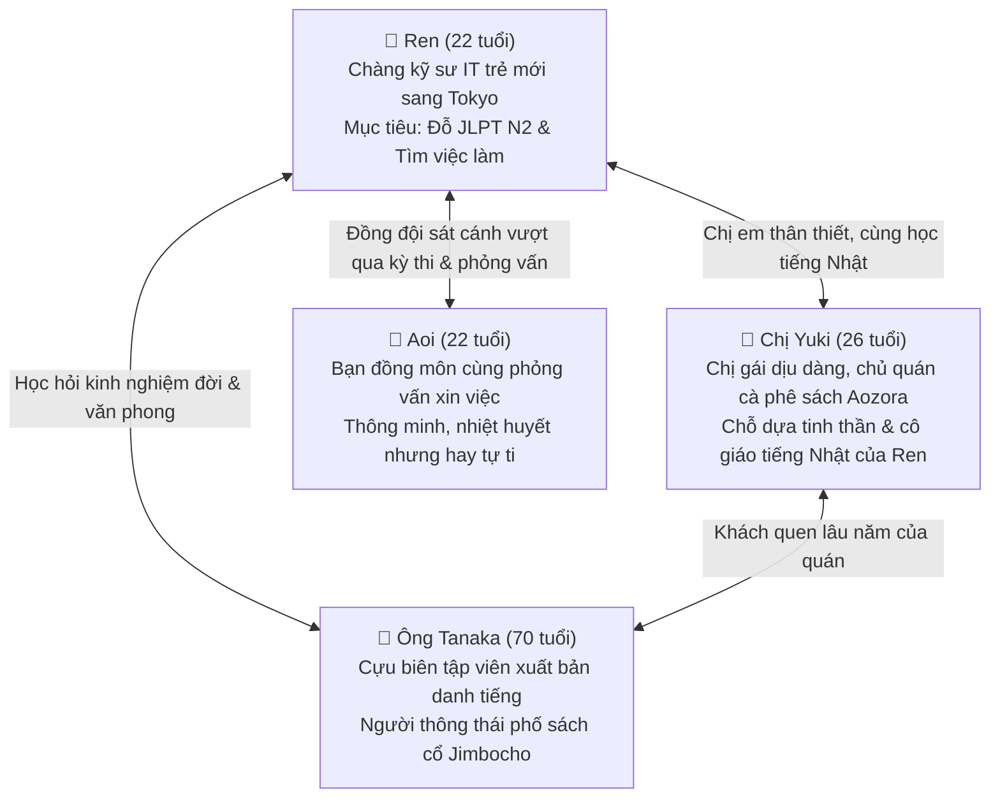

# 🌸 Seri Dài Tập: 「東京（とうきょう）あおぞら物語（ものがたり）」
### *(Câu Chuyện Bầu Trời Xanh Tokyo - Quyển Sổ Ước Mơ Của Ren Và Chị Yuki)*

Chào mừng bé cưng đến với bộ truyện dài tập chính thức của **PentaNihon**! ☕📖  
Thay vì những mẩu chuyện nhỏ rời rạc, từ nay mỗi ngày chúng ta sẽ cùng theo chân **Ren** và **chị Yuki** trải qua từng chặng đường phấn đấu, vượt khó, học tập và trưởng thành giữa lòng thủ đô Tokyo hoa lệ.

---

## 👥 Tuyến Nhân Vật Chính Xuyên Suốt Series

---

## 🗺️ Cốt Truyện Toàn Cảnh (Storyline Overview)

- **Phần 1: Khởi Đầu Mới Nơi Phố Sách Jimbocho (Tập 01 - Tập 07)**  
  Ren đặt chân đến Tokyo với chiếc vali trĩu nặng và nỗi lo toan. Cậu tìm thấy mái nhà ấm áp tại quán cà phê sách *Aozora* của chị Yuki, bắt đầu hành trình học tiếng Nhật N2 thực chiến và viết bản sơ yếu lý lịch đầu tiên.
- **Phần 2: Thử Thách Phỏng Vấn & Kỳ Thi Mùa Đông (Tập 08 - Tập 15)**  
  Những vòng phỏng vấn cân não tại Akihabara, những đêm thức trắng giải đề Shinkanzen, tình bạn với Aoi và những bài học ứng xử công sở Nhật Bản từ ông Tanaka.
- **Phần 3: Vươn Ra Biển Lớn (Tập 16+)**  
  Ngày nhận thư mời nhận việc (Naitei), ngày nhận kết quả thi JLPT và chặng đường mới dưới bầu trời xanh Tokyo.

---

## 📚 Danh Sách Các Tập Truyện Đang Phát Hành (Mỗi Ngày 1 Tập)

| Tập | Tên tập phim (Nhật - Việt) | Ngữ pháp N2 trọng tâm | Tình trạng |
| :---: | :--- | :--- | :---: |
| **01** | [**東京（とうきょう）駅（えき）のスーツケース** *(Chiếc Vali Ở Ga Tokyo)*](./series-01_tap-01_chiec_vali_ga_tokyo.md) | `〜際して`, `〜たとたん`, `〜てたまらない`, `〜にほかならない` | ✅ Đã phát hành |
| **02** | [**珈琲（コーヒー）の香（かお）りと最初（さいしょ）の約束（やくそく）** *(Hương Cà Phê Và Lời Hứa Ban Đầu)*](./series-01_tap-02_tach_ca_phe_aozora.md) | `〜からこそ`, `〜ものなら`, `〜わけにはいかない`, `〜つつある` | ✅ Đã phát hành |
| **03** | [**古書店街（こしょてんがい）の老人（ろうじん）と履歴書（りれきしょ）** *(Ông Lão Phố Sách Cổ & Bản Sơ Yếu Lý Lịch)*](./series-01_tap-03_ong_lao_pho_sach.md) | `〜を契機に`, `〜にもかかわらず`, `〜どころか`, `〜にすぎない` | ✅ Đã phát hành |
| **04** | [**渋谷（しぶや）の夕立（ゆうだち）と偶然（ぐうぜん）の再会（さいかい）** *(Cơn Mưa Rào Shibuya & Cuộc Gặp Gỡ Bất Ngờ)*](./series-01_tap-04_con_mua_shibuya.md) | `〜一方（で）`, `〜ざるを得ない`, `〜に違いない`, `〜まい` | ✅ Đã phát hành |
| **05** | [**一次（いちじ）面接（めんせつ）の扉（とびら）を開（あ）けて** *(Cánh Cửa Phỏng Vấn Vòng Một)*](./series-01_tap-05_canh_cua_phong_van.md) | `〜に応じて`, `〜限り`, `〜抜く`, `〜末に` | ✅ Đã phát hành |
| **06** | [**神保町（じんぼうちょう）の冬（ふゆ）の夜（よる）とユキ姉（ねえ）の過去（かこ）** *(Đêm Đông Jimbocho & Ký Ức Của Chị Yuki)*](./series-01_tap-06_dem_dong_jimbocho.md) | `〜にほかならない, 〜どころか, 〜にすぎない, 〜からこそ` | ✅ Đã phát hành |
| **07** | [**運命（うんめい）の12月（じゅうにがつ）！ JLPT N2決戦（けっせん）の日（ひ）** *(Tháng 12 Định Mệnh! Ngày Quyết Chiến JLPT N2)*](./series-01_tap-07_ngay_quyet_chien_jlpt.md) | `〜に際して, 〜を契機に, 〜ざるを得ない, 〜抜く` | ✅ Đã phát hành |
| **08** | [**役員（やくいん）面接（めんせつ）と青空（あおぞら）の誓（ちか）い** *(Phỏng Vấn Ban Giám Đốc & Lời Thề Dưới Bầu Trời Xanh)*](./series-01_tap-08_phong_van_ban_giam_doc.md) | `〜を込めて, 〜に相違ない, 〜のみならず, 〜かねない` | ✅ Đã phát hành |
| **09** | [**合格（ごうかく）通知（つうち）と涙（なみだ）の内定（ないてい）** *(Giấy Báo Đỗ & Nước Mắt Ngày Nhận Naitei)*](./series-01_tap-09_giay_bao_do_va_naitei.md) | `〜にほかならない, 〜やまない, 〜からには, 〜に違いない` | ✅ Đã phát hành |
| **10** | [**初（はつ）出社（しゅっしゃ）の緊張（きんちょう）と最初（さいしょ）の壁（かべ）** *(Ngày Đầu Tiên Đi Làm & Bức Tường Thử Thách)*](./series-01_tap-10_ngay_dau_tien_di_lam.md) | `〜にあたって, 〜まい, 〜一方（で）, 〜ざるを得ない` | ✅ Đã phát hành |
| **11** | [**失敗（しっぱい）から学（まな）ぶプロフェッショナルの誇（ほこ）り（第11話）** *(Học Hỏi Từ Thất Bại & Niềm Tự Hào Chuyên Nghiệp (Tập 11))*](./series-01_tap-11_aozora_tokyo.md) | `〜まい, 〜てたまらない, 〜のみならず, 〜を込めて` | ✅ Đã phát hành |
| **12** | [**神保町（じんぼうちょう）の週末（しゅうまつ）と未来（みらい）への語（かた）らい（第12話）** *(Cuối Tuần Ở Jimbocho & Cuộc Trò Chuyện Về Tương Lai (Tập 12))*](./series-01_tap-12_aozora_tokyo.md) | `〜つつある, 〜にすぎない, 〜ものなら, 〜からには` | ✅ Đã phát hành |
| **13** | [**アオイの挑戦（ちょうせん）と仲間（なかま）の温（あたた）かい応援（おうえん）（第13話）** *(Thử Thách Của Aoi & Sự Tiếp Sức Ấm Áp Của Đồng Đội (Tập 13))*](./series-01_tap-13_aozora_tokyo.md) | `〜に違いない, 〜に際して, 〜やまない, 〜かねない` | ✅ Đã phát hành |
| **14** | [**東京（とうきょう）の青空（あおぞら）と次（つぎ）なる高（たか）みへ（第14話）** *(Bầu Trời Xanh Tokyo & Khát Vọng Chinh Phục Đỉnh Cao Mới (Tập 14))*](./series-01_tap-14_aozora_tokyo.md) | `〜を契機に, 〜限る, 〜とともに, 〜にほかならない` | ✅ Đã phát hành |
| **15** | [**職場（しょくば）の絆（きずな）と果（は）たすべき約束（やくそく）（第15話）** *(Tình Thân Công Sở & Lời Hứa Phải Hoàn Thành — Vận Dụng Từ Vựng Bài 01)*](./series-01_tap-15_quan_he_cong_so_va_loi_hua.md) | `〜に際して, 〜一方（で）, 〜に相違ない, 〜を込めて` | 🌟 MỚI RA MẮT |
| **16** | [**深夜（しんや）の危機（きき）と問題（もんだい）解決（かいけつ）（第16話）** *(Khủng Hoảng Lúc Nửa Đêm & Bản Lĩnh Xử Lý Sự Cố (Tập 16))*](./series-01_tap-16_aozora_tokyo.md) | `〜ざるを得ない, 〜末に, 〜どころか, 〜一方（で）` | ✅ Đã phát hành |

---

## 🌟 Chuyên Mục Đặc Biệt: Mỗi Ngày Một Câu Thực Chiến (今日の実践フレーズ)

👉 [**Khám phá Sổ Tay 30 Ngày Mỗi Ngày Một Câu Vận Dụng Từ Vựng Shinkanzen N2**](./daily-vocab-quotes.md)  
*Mỗi ngày một câu nói tiếng Nhật đắt giá trích xuất từ câu chuyện của Ren, giúp ghi nhớ và vận dụng tự nhiên vào giao tiếp đời thực.*

---

### 🗄️ Lưu Trữ Các Mẩu Truyện Ngắn Cũ (One-shots)
Các câu chuyện độc lập trước đây đã được lưu trữ an toàn tại thư mục [story/oneshots/](./oneshots/):
- [秋のパン屋と一期一会の出会い (Tiệm bánh mì mùa thu)](./oneshots/story-01_tiem_banh_mua_thu.md)
- [夜行列車と明日への切符 (Chuyến tàu đêm)](./oneshots/story-02_chuyen_tau_dem.md)
- [雨音のカフェと忘れ物の傘 (Quán cà phê ngày mưa)](./oneshots/story-03_quan_ca_phe_ngay_mua.md)
- [遅咲きの桜と新しい旅立ち (Hoa anh đào nở muộn)](./oneshots/story-04_hoa_anh_dao_no_muon.md)
